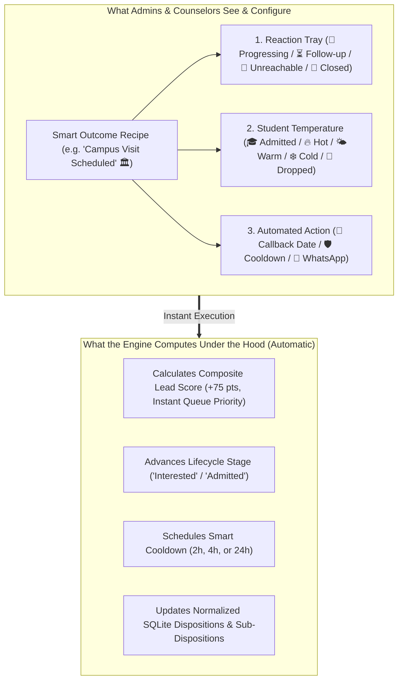
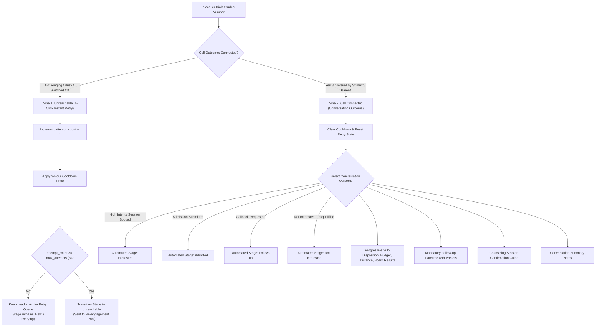

# 🎓 Admissions Playbook, Smart Outcomes Studio & Telecalling Framework

This guide covers the **Admissions Playbook & Smart Outcomes Studio**, the **4 Reaction Trays**, the **Frictionless Outcome Recipe Modal**, the **Dynamic Composite Lead Ranking Engine**, **Telecalling Retry Cadence**, and **Supervisory Stage Locking** in DreamDesk CRM.

---

## 1. Abstracting Telecom Complexity: The Admissions Playbook Mental Model

In traditional CRM software, telecalling configuration is burdened with confusing telecom jargon:
- Arcane codes: `ADM_SUBMITTED`, `INT_HIGH`, `CB_REQ`, `RNR`.
- Nested multi-level drop-downs and manual score mathematical weights.
- Multi-select campaign mapping checkboxes.

DreamDesk CRM abstracts this technical plumbing into a clear, human mental model: **The Admissions Playbook & Smart Outcome Recipes**.

Academic administrators and counselors don't think in terms of database tables; they think in terms of:
1. *What did the student or parent say?*
2. *What is their level of interest?*
3. *What should happen next?*



---

## 2. The 4 Visual Reaction Trays

Both in the **Admissions Playbook Studio** (`PlaybookStudioWorkspace.tsx`) and in the **Telecaller Call Drawer** (`EnhancedLeadDrawer.tsx`), outcomes are organized into 4 unmistakable color-coded reaction trays:

| Reaction Tray | Color Accent | Purpose & Workflow | Automated Engine Reaction |
|---|---|---|---|
| 🌟 **Progressing Forward** | Emerald (`#10b981`) | High-intent candidates moving actively toward admission (e.g., *Admission Form Submitted*, *Campus Tour Scheduled*, *Ready to Apply*). | Awards top score points (+75 to +100), updates stage to *Interested* or *Admitted*, and prioritizes in staff queues. |
| ⏳ **Needs Follow-up** | Amber (`#f59e0b`) | Active conversations requiring another consultation (e.g., *Discussing with Parents*, *Fee Details Shared*, *Awaiting CUET/12th Results*). | Enforces mandatory callback date & time selection with 1-click presets (+2h, Tomorrow 11 AM) and keeps lead in follow-up queues. |
| 📵 **Couldn't Connect** | Blue (`#3b82f6`) | 1-tap fast retry logging for unreached attempts (*Ringing No Answer*, *Switched Off*, *Busy*). | Increments `attempt_count`, triggers smart cooldown rest (2h–4h), does NOT mark as contacted, and auto-advances queue. |
| 🛑 **Closed / Dropped** | Rose (`#ef4444`) | Disqualified candidates (*Enrolled Elsewhere*, *Ineligible*, *Not Interested*). | Applies negative score adjustment (-30 to -50), updates stage to *Not Interested*, and safely archives the lead. |

---

## 3. The Frictionless Outcome Recipe Modal (`PlaybookOutcomeModal.tsx`)

Admins can customize existing outcomes or add new recipes in seconds through a modern, single-column modal:

1. **Clean Single-Column Flow (`sm:max-w-xl`)**:
   - Zero horizontal split-screen cramp; fits comfortably on any laptop or desktop screen.
   - Natural top-to-bottom visual hierarchy with no numbered-step fatigue.
2. **Click-to-Pick Emoji Popover**:
   - Integrated button opening a curated 24-emoji grid that closes reliably on outside click.
3. **1-Click Starter Presets**:
   - Pre-filled template pills (`🔥 Interested`, `🎓 Admitted`, `⏳ Follow-up`, `👨‍👩‍👧 Parents`, `📳 No Answer`) that pre-fill title, tray, score, and default tags in one click.
4. **Smart Category Defaults**:
   - Clicking a Category Tray automatically sets recommended Intent Levels and Callback requirements.
5. **Student Temperature Picker**:
   - 5 simple visual pills (`🎓 +100`, `🔥 +75`, `🌤️ +35`, `❄️ 0`, `🛑 -30`) with a 1-line plain-language explanation of stage impact.
6. **Effortless Sub-Reason Tags**:
   - Removable chips with 1-click suggested additions (`+ Fee Details`, `+ Campus Visit`, `+ Hostel Query`, `+ Location Far`).
7. **Natural Action Bar**:
   - Cancel and Save buttons placed naturally at the bottom of the form where user focus ends.

---

## 4. 1-Click Starter Playbook Packs

The Admissions Playbook includes 3 pre-built institutional templates ready for 1-click deployment:

1. 🎓 **Undergrad & College Admissions**: Standard admissions cycle (Campus visits, parent consultations, scholarship queries, mark sheet verification).
2. ⚙️ **Engineering & STEM Admissions**: Tailored for JEE Mains/Advanced ranks, branch selection (CSE, AI/ML, ECE), and hostel availability.
3. 💼 **MBA & Post-Graduate Admissions**: Tailored for CAT/MAT/GMAT percentiles, GD/PI interview rounds, and corporate sponsorship.

---

## 5. Composite Lead Ranking & Dynamic Scoring Engine

DreamDesk CRM dynamically ranks every student lead based on academic merit and verified phone consultation outcomes:

$$\text{Composite Score} = (\text{Academic Merit} \times W_{acad}) + (\text{Outcome Score} \times W_{disp}) - (\text{Attempt Penalty} \times \text{Attempts})$$

- **Configurable Weights**: Managed live from the Playbook Studio calibration panel:
  - `academic_weight` (Default: 40%)
  - `disposition_weight` (Default: 60%)
  - `attempt_penalty` (Default: 5 points per unanswered dial)
  - `high_intent_threshold` (Default: 70 points for "Hot" candidate badge)
- **Automatic Recalculation**: Every saved call outcome immediately recalculates the lead's composite score and re-ranks queues in real time.

---

## 6. Core Operating Philosophy: "Unreachable Is an Attempt, Not Contact Proof"

In high-volume education admissions, telecallers make 80–150 outreach calls daily. A fundamental flaw of legacy CRMs is marking any dialed number as *"Contacted"*, which:
- Falsely inflates contact and outreach metrics.
- Causes unanswered leads to be abandoned prematurely.
- Skews counselor conversion rates.

### DreamDesk CRM Distinguishes Between:
1. **Call Attempt (Unreachable)**: Ringing No Answer, Busy, Switched Off, Invalid Number.
   - **Does NOT** mark the student as *Contacted*.
   - Increments the student's `attempt_count` (e.g., Attempt #1 of 3).
   - Enforces an automated **cooling-off period** (default: 3 hours) via `cooldown_until`.
   - **Keeps the lead eligible for retries** in the `New` or active retry queue.
   - Only when max retry limits are exhausted (e.g., 3 attempts) is the lead transitioned to the `Unreachable` pool.
2. **Contact Proof (Connected)**: Answered by student or parent.
   - Confirms true two-way communication.
   - Clears any cooldown timers.
   - Progressively transitions the lead to *Interested*, *Follow-up*, *Admitted*, or *Not Interested*.



---

## 2. The 8-Field Telecalling Framework

DreamDesk CRM structures every consultation according to this exact operational matrix:

| Field | Required? | Operating Behavior |
| :--- | :--- | :--- |
| **1. Call Outcome** | **Always** | **Answered vs. Unreachable**. Defines whether contact proof was established or if the interaction was merely an outreach attempt. |
| **2. Disposition** | **Always (when answered)** | Selects the meaningful conversation milestone (*Interested - High Intent*, *Callback Requested*, *Counseling Session Booked*, *Not Interested*). |
| **3. Sub-disposition** | **Conditional** | **Progressively revealed** only when the chosen disposition has relevant sub-reasons (e.g. *Tuition Fee Budget*, *Location / Hostel*, *Comparing Competitors*, *Waiting for Board Results*). |
| **4. Callback Date & Time** | **Conditional** | **Mandatory** only when a follow-up callback is requested. Features 1-tap quick presets: `+2 Hours`, `Tomorrow 11 AM`, `Tomorrow 4 PM`, `Next Monday`. |
| **5. Counseling Booking** | **Conditional** | Appears when *Counseling Session Booked* is selected, prompting the caller to specify campus visit vs. online consultation and remind the student of required 10th/12th marksheets. |
| **6. Notes** | **Conditional / Optional** | Discussion summary and key student takeaways; automatically prefixed with duration and timestamps. |
| **7. Student Details** | **Only When Needed** | Academic parameters (stream, board, score, preferred campus) are editable in the *Fields* tab and identity cards without blocking fast calling. |
| **8. Lead Stage** | **Automatic (CRM-driven)** | **Calculated automatically** from validated rules. Non-supervisory staff (telecallers, counselors) cannot arbitrarily override the stage; manual override requires Supervisor (`admin` or `team_lead`) authorization. |

---

## 3. The 2-Zone Outcome Controller

Both the **Speed Dialer Workspace** (`SpeedDialerWorkspace.tsx`) and the **Student Profile Drawer** (`EnhancedLeadDrawer.tsx`) feature the 2-Zone Outcome Controller:

### Zone 1: Unreachable / Did Not Connect (1-Click Instant Retry)
- **Target Velocity**: < 0.5 seconds per logged attempt.
- **4 Instant Chips**:
  1. 📞 `Ringing - No Answer` (`RNR`)
  2. 📵 `Line Busy / Cut` (`BUSY`)
  3. 📴 `Switched Off / Network` (`SWITCH_OFF`)
  4. 🚫 `Invalid / Wrong Number` (`INVALID_NUM`)
- **Behavior**:
  - 1-click logs the attempt without requiring notes or multi-step wizard modals.
  - Automatically advances to the next student in the queue if auto-advance is toggled on.
  - Registers `call_attempt` audit trail entry with attempt count and cooldown timestamp.

### Zone 2: Call Connected (Student Conversation)
- **Target Velocity**: Structured, comprehensive logging.
- **Visual Categorized Chips**:
  - **Positive / High Intent**: *Admission Form Submitted* (+100 score), *Counseling Session Booked* (+85), *Interested - High Intent* (+70).
  - **Neutral / Follow-up**: *Callback Requested* (+40), *Follow-up Needed* (+30), *Parent Discussion Pending* (+25).
  - **Negative / Disqualified**: *Not Interested* (-20), *Joined Another College* (-50), *Do Not Call (DND)* (-100).
- **Behavior**:
  - Reveals nested sub-disposition dropdowns.
  - Shows dynamic objection-handling talking points (e.g., fee installment plans, scholarship exams, campus bus routes).
  - Validates callback dates before allowing submission.
  - Updates lead stage and lead scoring in real time.

---

## 4. Dialing Cadence, Cooldowns & Policy Configuration

Retry rules are managed via the `crm_policies` database table (`dialer_retry_policy`):

```json
{
  "max_attempts": 3,
  "cooldown_hours": 3,
  "exhausted_status": "Unreachable"
}
```

### Visual Indicators Across the Platform:
- **Card Badges**: `Att #1/3`, `Att #2/3`, `Att #3/3 (Max)`.
- **Active Cooldown Pill**: `⏳ Cooldown` displayed in blue with pulsing animation, showing the time until the lead becomes eligible for re-dialing.
- **Relative Timestamps**: `Last: 12m ago` or `Last: 2h ago` on queue cards and desk headers.

---

## 5. Supervisory Stage Locking & Anti-Pollution Governance

To maintain data integrity and prevent reporting discrepancies, counselors cannot arbitrarily change the lifecycle stage of a lead from dropdowns.

### Governance Rules:
1. **Counselor / Telecaller Mode (`!isExemptRole`)**:
   - The *Admission Stage* selector is locked (`disabled`).
   - A lock badge (`🔒 Auto-Calculated`) explains:
     > *"Stage is calculated automatically by CRM from validated call outcomes. Manual stage overrides require Supervisor (Admin / Team Lead) permission."*
   - Direct API attempts to alter `status` via inline updates are rejected by `leadsService.ts` with a policy violation error.
2. **Supervisor Mode (`admin` / `team_lead`)**:
   - Stage dropdown is fully editable with a `🛡️ Supervisor Override` badge.
   - Any manual stage adjustment is recorded in `lead_activities` with the title:
     `Stage Changed: New → Interested (Supervisor Override)`

---

## 6. Real-World Use Case Scenarios

### Scenario A: Fast Morning Telecalling Run (80 Numbers in 45 Minutes)
- **Operator**: Telecaller working through a fresh batch of 150 inquiries from the Delhi Education Fair.
- **Workflow**:
  1. Opens **Speed Dialer Desk**.
  2. Numbers 1 through 4 ring without an answer. The telecaller clicks **`Ringing - No Answer`** once for each.
  3. In under 2 seconds, all 4 are recorded as `Attempt #1/3` with a 3-hour cooldown, and the desk auto-advances.
  4. Number 5 answers. The telecaller speaks with the candidate, selects **`Interested - High Intent`**, chooses sub-disposition **`Fee Structure Shared`**, and sets a callback for tomorrow at 11 AM.
  5. The lead stage automatically shifts to **`Follow-up`**, clearing all retries.

### Scenario B: Exhaustion & Automated Segregation
- **Student**: Inquires online but never picks up after 3 consecutive attempts spaced across 3 days.
- **System Action**:
  - Attempt 1: Increment to `Att #1/3`, 3h cooldown, stage remains `New`.
  - Attempt 2: Increment to `Att #2/3`, 3h cooldown, stage remains `New`.
  - Attempt 3: Increment to `Att #3/3`. Since max attempts is reached, stage automatically transitions to **`Unreachable`**.
  - Lead is removed from primary caller queues and routed to the **WhatsApp / SMS drip campaign re-engagement pool**.

---

## 7. Navigation Gatekeeper & Multi-Page Auto-Advancing Stepper

To eliminate operator mistakes and lost consultation notes during fast telecalling:

1. **Call Navigation Gatekeeper (`isNavigationLocked`)**:
   - When a call outcome button is selected or a conversation is active, the drawer prevents switching to other candidates via keyboard hotkeys (<kbd>[</kbd> / <kbd>]</kbd>) or clicking rows until the call outcome is saved or explicitly cancelled.
   - A friendly warning toast reminds the caller: *"Please save the call outcome before navigating to another student."*
2. **Multi-Page Filtered Stepper**:
   - The profile drawer supports seamless keyboard stepping (<kbd>[</kbd> / <kbd>]</kbd>) through filtered cohorts, automatically loading subsequent pages without closing the drawer.
3. **Instant Auto-Advancement**:
   - Saving any call outcome automatically slides smoothly to the next candidate in the queue, cutting out 2–3 mouse clicks per student.

---

## 8. Technical Schema & Dynamic SQLite Tables

### Dynamic Outcomes Tables:
```sql
CREATE TABLE IF NOT EXISTS dispositions (
  id TEXT PRIMARY KEY,
  name TEXT NOT NULL,
  code TEXT UNIQUE NOT NULL,
  category TEXT NOT NULL CHECK(category IN ('positive', 'neutral', 'negative', 'unreachable')),
  color TEXT NOT NULL DEFAULT '#3b82f6',
  score INTEGER NOT NULL DEFAULT 0,
  requires_callback INTEGER NOT NULL DEFAULT 0,
  is_active INTEGER NOT NULL DEFAULT 1,
  created_at DATETIME DEFAULT CURRENT_TIMESTAMP
);

CREATE TABLE IF NOT EXISTS sub_dispositions (
  id TEXT PRIMARY KEY,
  disposition_id TEXT NOT NULL,
  name TEXT NOT NULL,
  code TEXT,
  score INTEGER NOT NULL DEFAULT 0,
  FOREIGN KEY (disposition_id) REFERENCES dispositions(id) ON DELETE CASCADE
);

CREATE TABLE IF NOT EXISTS campaign_dispositions (
  campaign_id TEXT NOT NULL,
  disposition_id TEXT NOT NULL,
  PRIMARY KEY (campaign_id, disposition_id),
  FOREIGN KEY (campaign_id) REFERENCES campaigns(id) ON DELETE CASCADE,
  FOREIGN KEY (disposition_id) REFERENCES dispositions(id) ON DELETE CASCADE
);

CREATE TABLE IF NOT EXISTS lead_scoring_policies (
  id TEXT PRIMARY KEY,
  academic_weight REAL NOT NULL DEFAULT 0.40,
  disposition_weight REAL NOT NULL DEFAULT 0.60,
  attempt_penalty REAL NOT NULL DEFAULT 5.0,
  high_intent_threshold REAL NOT NULL DEFAULT 70.0,
  auto_recalculate_on_call INTEGER NOT NULL DEFAULT 1,
  updated_at DATETIME DEFAULT CURRENT_TIMESTAMP
);
```

### Key API Endpoints:
- `GET /api/dispositions`: Fetch active dispositions with nested sub-dispositions and linked campaigns.
- `POST / PATCH / DELETE /api/dispositions`: Dynamic outcome creation, updates, and deactivation.
- `POST / DELETE /api/dispositions/sub`: Dynamic sub-disposition chip insertion and deletion.
- `GET / POST /api/dispositions/scoring-config`: Fetch and calibrate composite lead ranking weights.
- `POST /api/leads/[id]/disposition`: Log call outcome, update stage, set callback time, and trigger score recalculation.
