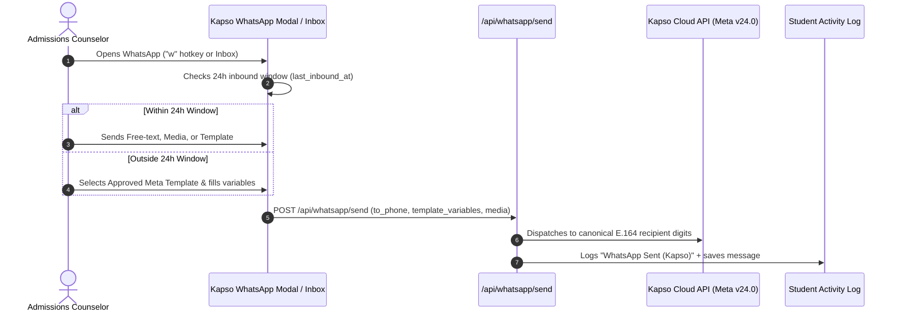

# 💬 Kapso Integrated WhatsApp, Multi-Contact Routing & Communications Guide

This guide covers the **Kapso Cloud API WhatsApp Integration**, **Role-Scoped Inbox**, **Meta Template Studio**, **24-Hour Window Guard**, and **Multi-Contact Channel Routing** in DreamDesk CRM (with all external `wa.me` links completely removed).

---

## 1. Feature Overview & Purpose

In student admissions, WhatsApp is the highest-engagement communication channel. DreamDesk CRM embeds WhatsApp directly inside the platform via **Kapso (`https://api.kapso.ai`)**:
- **Zero External Links**: All `wa.me` redirects are removed; counselors message, preview templates, upload media, and read full chat history directly inside the CRM.
- **24-Hour Customer Service Window Check**: Enforces Meta's 24h rule before allowing **Free-text Reply** (`last_inbound_at`). Outside the 24h window (or when no inbound reply exists yet), Free-text Reply is locked and the modal automatically switches to **Approved Meta Template**.
- **Role-Scoped WhatsApp Inbox (`WhatsAppInboxWorkspace.tsx`)**: Counselors strictly see complete chat history for leads assigned to them; Admins/Team Leads also see unlinked inbound inquiries (`Not in CRM`) with a 1-click **+ Save as Lead** action.
- **Realistic Bubble Preview (`WhatsAppTemplateBubblePreview.tsx`)**: Previews `TEXT`, `IMAGE`, `VIDEO`, and `DOCUMENT` headers, live variable substitutions, footers, read ticks, and interactive Meta buttons (`QUICK_REPLY`, `URL`, `PHONE_NUMBER`, `COPY_CODE`).



---

## 2. Meta Template Studio & Drag-and-Drop CRM Placeholders

*Component*: `MetaKapsoTemplateStudio.tsx` | *API*: `/api/whatsapp/templates`, `/api/whatsapp/templates/sync`, `/api/whatsapp/media`

- **Sync & Authoring**: Sync existing approved templates from Meta/Kapso or submit new `UTILITY` / `MARKETING` / `AUTHENTICATION` templates (`NAMED` `{{student_name}}` or `POSITIONAL` `{{1}}`).
- **Headers & Media Upload**: Supports `NONE`, `TEXT`, `IMAGE`, `VIDEO`, and `DOCUMENT` headers uploaded directly to Kapso Media (`/meta/whatsapp/v24.0/{phone_number_id}/media`).
- **Drag-and-Drop CRM Field Placeholders**: Drag CRM schema chips (`Student Name`, `Lead Code`, `Stream`, `City`, custom Schema Studio fields) directly into the Template Body or onto any row in the structured **Variable Fields & CRM Header Mapping** form outside the body.

---

## 3. Multi-Contact Channel Routing (Call/IVR vs WhatsApp)

A single student lead can hold multiple linked numbers (`Primary`, `Father`, `Mother`, `Guardian`, `Alternate`) in `leads.phone` and `leads.alternate_contacts`:
- **Call / IVR (`Set Primary`)**: Designates `leads.phone` as the default number for click-to-call (`tel:`) and IVR dialing.
- **WhatsApp (`Set WA` / `whatsapp_phone`)**: Designates which linked number is used by default for WhatsApp outreach (falls back to `leads.phone` when unset).
- **In-Modal Picker**: In `WhatsAppModal`, counselors can switch between any linked contact on the lead before sending.

---

## 4. Direct Softphone & Click-to-Call (`tel:`)

Beside WhatsApp, the CRM provides desktop softphone and mobile dialing:
- **Hotkey Dialing**: Press <kbd>c</kbd> on any row or inside the profile drawer to trigger click-to-call immediately.
- **Protocol**: Triggers standard `tel:+91XXXXXXXXXX` URI (handled natively by Android's dialer in the `mobile/` WebView wrapper).
- **Call Disposition Trigger**: After hanging up, the disposition drawer automatically prompts the counselor to log the outcome.

---

## 5. 🏫 Real-World Use Case Scenarios

### Scenario A: Instant Post-Call Brochure Dispatch
- **Context**: Counselor Sneha finishes a 12-minute phone consultation with a parent who requests the Aerospace Engineering fee schedule.
- **Workflow**:
  1. Closes phone call.
  2. Presses <kbd>w</kbd> on the active student.
  3. Selects template: *"Aerospace Engineering Fee Structure & Hostel Guide"*.
  4. Clicks **Send via WhatsApp**.
- **Result**: The parent receives the exact requested document within 10 seconds while the phone conversation is fresh in their mind.

### Scenario B: Mass Unanswered Call Re-Engagement
- **Context**: Telecaller Aditya places 20 outbound calls in the morning; 8 students do not answer.
- **Workflow**:
  1. For each unanswered call, logs disposition: `Ringing No Response`.
  2. Hits <kbd>w</kbd> and selects template: *"Missed Call Follow-up"*.
  3. Dispatches message with single click.
- **Result**: Over 40% of students reply on WhatsApp within the hour requesting an evening callback.

---

## 6. ⚙️ Database Schema Reference

### `whatsapp_templates` Table
```sql
CREATE TABLE whatsapp_templates (
  id TEXT PRIMARY KEY,
  name TEXT NOT NULL,
  category TEXT NOT NULL DEFAULT 'General',
  template_body TEXT NOT NULL,
  is_default INTEGER DEFAULT 0,
  created_at DATETIME DEFAULT CURRENT_TIMESTAMP
);
```

---

## Mobile Drawer Ergonomics, Multi-Contact & Swipe Navigation (`v1.3.x`)

- **Thumb-Friendly Call & WhatsApp Actions**: On mobile, `Call` and `WhatsApp` buttons (`h-11 w-11`) sit directly beside the student's name in `EnhancedLeadDrawer.tsx` for effortless one-handed tapping, without a redundant bottom bar.
- **Zero-Diary Multi-Contact (`phone_label`, `alternate_contacts`, `/api/leads/[id]/contacts`)**: Callers can store labeled secondary numbers (e.g., *Father*, *Mother*, *Alternate*) and pick which number to dial or WhatsApp in 1 tap.
- **Horizontal Swipe Navigation**: Callers can swipe left/right inside the mobile lead drawer to step through sequential leads smoothly.
