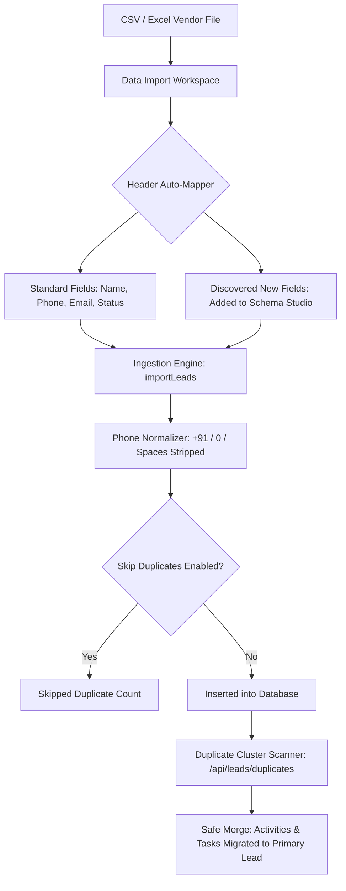

# 📥 Data Import, Deduplication & Clean Ingestion Guide

This guide covers the **Batch Ingestion Pipeline**, **Intelligent Header Auto-Mapping**, and **Zero-Data-Loss Duplicate Resolution Engine** in DreamDesk CRM.

---

## 1. Feature Overview & Purpose

Universities receive student leads from dozens of external sources: school visits, digital ads, education web portals (Shiksha, Collegedunia), and third-party agencies. This creates two massive operational challenges:
1. **Header Format Chaos**: Every vendor sends files with different column headers (*"Student Name"* vs *"Full Name"*, *"Mobile"* vs *"Contact Number"*).
2. **Duplicate Records & Data Fragmentation**: Students frequently register 3 or 4 times across different portals. Traditional CRMs either reject the file or duplicate the student, leading to two counselors calling the same student independently.

DreamDesk CRM solves this with:
- **Visual Column Auto-Mapper**: Automatically recognizes header synonyms and discovers new custom columns.
- **Canonical E.164 Phone Normalization & Validation (`phoneNormalizer.ts`)**: Converts valid numbers (`918695911105`, `+91 7002015274`, `09876543210`, `9876543210`) to canonical E.164 (`+91XXXXXXXXXX`), normalizes legacy rows on startup, and **rejects invalid/dummy numbers** with row-level error reporting.
- **3-Mode Multi-Contact Deduplication**: Matches uploaded rows against **both** primary `leads.phone` and secondary/guardian/caller-added contacts (`alternate_contacts` + phone attributes), with configurable handling:
  - **Skip Duplicates (Default)**: Skips matching rows and reports which lead & contact matched.
  - **Merge Missing Fields**: Fills blank fields and missing custom attributes on the existing lead without overwriting counselor assignment, primary phone, or stage.
  - **Import Anyway (Flag Radar)**: Creates the record (e.g., sibling sharing a parent number) and surfaces it in **Duplicate Radar**.



---

## Streaming Large CSV Ingestion & Background Job Console (`v1.3.5`)

- **Browser-Safe Upload (`ImportModal.tsx`)**: Parses only a 25-row preview in-browser for instant header detection and streams the raw CSV via `multipart/form-data` with a live upload progress bar.
- **Server-Side Background Execution (`/api/leads/import`, `JobsService`)**: Streams incoming files to disk (`data/uploads/`), enqueues a persistent SQLite `background_jobs` record, ingests in 500-row chunks via `Papa.parse`, and cleans up temporary files automatically — continuing even if the user closes the browser.
- **Live Task Log Console (`BackgroundJobsTracker.tsx`)**: Displays live progress bars alongside a terminal-style log viewer (`INFO`, `WARN`, `ERROR`) persisted in `background_jobs.logs`.
```

---

## 2. Component 1: Intelligent Header Auto-Mapping

When an operator uploads a CSV or Excel sheet:
1. The system inspects column headers and matches standard fields automatically:
   - `name`, `student_name`, `full_name`, `candidate` ➔ **Name**
   - `phone`, `mobile`, `contact`, `number`, `cell` ➔ **Phone**
   - `email`, `student_email`, `mail_id` ➔ **Email**
   - `status`, `stage`, `lifecycle` ➔ **Status**
   - `campaign`, `utm_source`, `source` ➔ **Campaign**
2. **Dynamic Header Discovery**:
   - Any unknown column (e.g. `hostel_required`, `parent_income`, `diploma_percentage`) is automatically identified.
   - The operator can map it to an existing schema key, create a new dynamic field on the fly, or select `__skip__`.

---

## 3. Component 2: Canonical E.164 Phone Normalization & Validation

*Implementation*: [`normalizeAndValidatePhone`](file:///C:/Users/Ramanuj%20Dey%20Sarkar/Desktop/New%20folder%20%282%29/DreamDesk%20CRM/src/lib/utils/phoneNormalizer.ts)

Phone numbers entered via CSVs, web forms, or counselor edits come in unpredictable formats (`+91 98765 43210`, `919876543210`, `09876543210`, `98765-43210`, or junk like `12345` / `0000000000`).
- **Canonical Storage**: Valid 10-digit Indian numbers are stored in `leads.phone` as `+91XXXXXXXXXX` with `leads.phone_digits` as `91XXXXXXXXXX` (international E.164 numbers `+` + 10–15 digits are preserved).
- **Strict Rejection**: Numbers shorter than 10 digits, containing letters, or repeating dummy digits are rejected during CSV ingestion (`rejectedCount`, `rejectedRows`) and contact creation.
- **Multi-Contact Duplicate Matching**: Both CSV ingestion and Duplicate Radar match normalized digits across primary `leads.phone`, `alternate_contacts`, and phone-like keys in `raw_attributes`.

---

## 4. Component 3: Safe Duplicate Merging (Zero Data Loss)

*Component*: [`DuplicatesModal.tsx`](file:///C:/Users/Ramanuj%20Dey%20Sarkar/Desktop/New%20folder%20%282%29/DreamDesk%20CRM/src/components/crm/DuplicatesModal.tsx) | API: `POST /api/leads/duplicates`

When duplicate inquiries exist in the database (e.g. a student registered once via Google Ads and once via an education expo):
1. **Cluster Detection**: The scanner groups duplicate leads by normalized phone number or email address, showing which counselor owns each record.
2. **Primary Record Selection**: The administrator selects which record survives as the primary profile (typically the record with the most counseling progress).
3. **Attribute Consolidation**: Notes, custom attributes, and lead scores from duplicate records are merged into the primary profile without overwriting existing data.
4. **Historical Activity & Task Re-Parenting**:
   - Before duplicate rows are deleted from the database, the engine re-parents foreign keys:
     ```sql
     UPDATE lead_activities SET lead_id = primaryLeadId WHERE lead_id IN (...duplicateIds);
     UPDATE crm_tasks SET lead_id = primaryLeadId WHERE lead_id IN (...duplicateIds);
     ```
   - **Result**: Zero past phone calls, notes, or scheduled callbacks are lost. The student's complete relationship history is united under one profile.

---

## 5. 🏫 Real-World Use Case Scenarios

### Scenario A: Ingesting 15,000 Leads from an Education Portal
- **Context**: An agency delivers a CSV with 15,000 leads. Approximately 2,000 students have already inquired directly on the university website.
- **Workflow**:
  1. Operations manager opens **Data Import**.
  2. Selects file: `shiksha_engineering_leads_october.csv`.
  3. Selects campaign: *"Online Portal Inflow"*.
  4. Checks: ☑ **Skip Duplicates (Match Phone)**.
  5. Clicks **Start Ingestion**.
- **Result**:
  - 13,000 fresh leads are imported and assigned lead codes (`LD-XXXXXX`).
  - 2,000 duplicate inquiries are safely skipped, preventing duplicate records.
  - The entire batch imports in under 3.5 seconds.

### Scenario B: Unifying Fragmented Student Inquiries
- **Context**: Student Aarav Patel submitted an inquiry in January (assigned to Counselor Sneha) and another inquiry in March with a different email address (assigned to Counselor Rohit).
- **Workflow**:
  1. Team Lead opens the **Duplicate Inquiries Studio**.
  2. The system flags the cluster: `Phone: 9876543210 (2 Records Found)`.
  3. Team Lead selects Sneha's profile as the primary surviving record.
  4. Clicks **Merge Records**.
- **Result**:
  - Rohit's duplicate row is safely retired.
  - All notes and calls placed by both counselors are merged into the unified timeline.
  - Sneha continues counseling the student with complete visibility into all past interactions.
